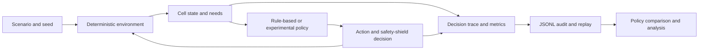

# ALGOCELL

**A deterministic artificial-cell simulation and policy-research prototype**  
**Source:** private repository  
**Status:** experimental research prototype; no independent scientific validation claimed

## Overview

ALGOCELL models a single artificial cell in a reproducible grid environment. The simulation exposes state changes and decisions so that rule-based and experimental learned policies can be compared through logs and replay rather than judged only by a final score.

## Engineering problem

Agent experiments are difficult to interpret when environment conditions, seeds, observations and action outcomes are not recorded consistently. ALGOCELL builds observability and repeatability into a small simulation so that behavior can be inspected step by step.

## Architectural approach

Python modules represent the cell, environment, planning, policies, scenario generation, model experiments, evaluation, audit records and replay. The documented protocol fixes scenario families, seeds, run budgets and policy comparisons. JSONL records and replay tooling preserve decision and state information for later analysis.

The diagram describes the implemented experiment structure; it does not assert that the learned policy outperforms the baseline.

## Verified technologies

Python 3.11+ package, deterministic simulation and experiment modules, JSONL audit/replay artifacts, and Python `unittest` test files. The package manifest does not declare a machine-learning framework dependency for the documented baseline prototype.

## Implemented capabilities visible in source

- Deterministic cell/environment modules and a runnable simulation entry point.
- Baseline and planning modules plus neural and reinforcement-learning experiment modules.
- Scenario generation, policy comparison, evaluation records and diagnostics.
- Audit/logging and replay utilities.
- Test files for core state, replay, audit, RL environment and experiment helpers; tests were not run for this preparation.
- A lightweight browser “microscope” interface documented in the project README.

## Technical challenges and design decisions

- **Reproducible comparisons:** scenario, seed, budget and policy are specified by a documented evaluation protocol.
- **Closed-loop evaluation:** policy quality is treated as behavior over time, not only prediction agreement.
- **Decision traceability:** logs distinguish the proposed action from the executed action when a safety shield intervenes.
- **Bounded claims:** the neural models are experimental baselines; the repository itself records unresolved stress and generalization concerns.

## Current status and limitations

The source contains simulation, model and evaluation infrastructure. It does not establish general intelligence, biological equivalence, robust learning or scientifically validated results. The project roadmap calls its V1 completion estimate an internal planning estimate, not a scientific metric; this case study intentionally omits that percentage. No experiment or test was rerun for this publication draft.

The repository includes a status document whose source-location and prior verification statements refer to an earlier staging layout. Those historical test results must not be presented as current verification without a fresh, owner-approved run.

## Lessons learned

- Make the environment and policy comparison protocol explicit before comparing results.
- Preserve intermediate decision traces so anomalies can be explained, not merely counted.
- Evaluate policies in closed loop and retain failure cases; a higher aggregate score is not sufficient evidence of better behavior.
- Separate code-level experimental capability from independently validated scientific conclusions.

## Evidence checked

Private-source review covered package metadata, simulation and policy components, neural and reinforcement-learning experiment modules, evaluation/replay/audit tooling, tests, and the protocol, anomaly and roadmap documents. Exact private source paths and unverified numerical results are omitted.

**Confidence:** high for implemented modules and documented evaluation structure; medium for experiment behavior; scientific validity and current test results not verified.
