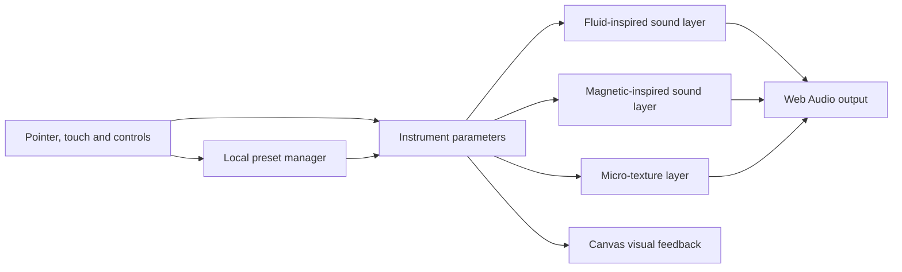

# Armonium

**A browser-based audiovisual instrument prototype**  
**Source:** private repository  
**Status:** creative-technology prototype; cross-browser and long-session validation remains open

## Overview

Armonium is an interactive browser instrument that connects visual, touch and gesture-oriented controls to layered sound synthesis. Its selected baseline is the standalone v3 prototype, with a small preset system that stores user-created settings locally in the browser.

## Engineering problem

The project explores how continuous visual and tactile interaction can shape generated sound in real time. It also addresses practical browser constraints: audio starts only after user interaction, hidden canvases need correct sizing, and input controls must remain usable on touch devices.

## Architectural approach

The baseline is a browser page with JavaScript modules for the principal synthesis layers and gesture handling. The page creates a Web Audio context after an explicit user action, connects controls to audio parameters and visualizations, and loads a preset manager. Custom presets are stored in local storage rather than synchronized to a server.

The diagram summarizes the documented v3 baseline and source structure; it is not an audio-performance measurement.

## Verified technologies

HTML and JavaScript with browser Web Audio, Canvas, pointer/touch and local-storage APIs. The selected baseline does not require a server-side application or account system for its local preset behavior.

## Implemented capabilities visible in source

- Standalone HTML/JavaScript baseline and separate synthesis-layer modules.
- Web Audio context initialization behind user interaction.
- Touch/pointer controls, gesture handling and canvas visualizations.
- Default and user-saved preset management through browser local storage.
- Project notes documenting manual checks and remaining compatibility work.

## Technical challenges and design decisions

- **Browser audio lifecycle:** audio context startup must follow a user gesture.
- **Interactive visual state:** visualization sizing must account for hidden tabs or panels.
- **Touch and gesture mapping:** gestures are functional in the project’s notes but still require artistic calibration.
- **Small, understandable baseline:** v3 was selected over a larger historical branch because it is easier to inspect and avoids assuming unfinished voice and modular features work.
- **Local persistence:** presets remain on the device, with no account or synchronization system.

## Current status and limitations

Project notes report successful checks for core controls, touch, visualizations, micro-texture and special gestures. They also list browser/device coverage and long-session console checks as remaining work, and the recovery notes have checklist entries whose chronology should be reconciled before publication. This preparation did not launch the instrument or verify sound output.

Voice control, the older v5.2 modular branch, hardware integration and plugin formats are not part of the selected baseline. The project is an experimental creative instrument, not a finished audio product.

## Lessons learned

- Browser interaction is both a technical and artistic design problem: functioning gestures still need listening-based calibration.
- Explicitly recording unverified audio paths prevents a page load from being mistaken for working synthesis.
- A compact baseline is a better demonstration than a larger branch with unverified features.
- Local-only state should be described clearly so users do not expect cloud synchronization.

## Evidence checked

Private-source review covered the project overview, selected browser baseline, synthesis and gesture components, local preset manager, and recovery, roadmap and inventory notes. Exact private source paths are intentionally omitted.

**Confidence:** high for the baseline structure and local preset behavior; medium for previously documented interactions; audio output, compatibility and performance not rechecked.
