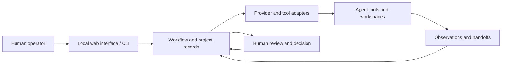

# HIVECORE

**A locally operated coordination layer for persistent AI-agent teams**  
**Source:** private development repository  
**Status:** development project; no production-readiness claim

## Overview

HIVECORE explores how multiple coding and task-focused agents can work as a continuing team rather than as disconnected sessions. It provides a local operator interface and a workflow model for collecting observations, forming proposals, reviewing decisions and handing work between agents.

The project README describes HIVECORE as a maintained derivative of the Agency codebase. The available project documentation does not identify a more specific upstream version or distinguish the derivative's components from upstream components.

## Engineering problem

Agent tools often have different execution environments, workspace models and output conventions. The project addresses the coordination work around them: identity and configuration, persistent project records, handoffs, operator visibility and human decision points.

## Architectural approach

The Python application combines a web interface and CLI with configuration and workflow modules, provider/tool integrations, workspace adapters, and file-backed project records. Integration adapters normalize execution results while keeping tool-specific behavior at the boundary. The workflow surface gives the operator a place to inspect results and make decisions.

The diagram shows the conceptual flow between the operator, workflows, adapters, and agent tools; it is not a deployment or security model.

## Technology Stack

Python 3.11+, FastAPI/Starlette, Uvicorn, Jinja2, PyYAML, and Click are declared or used by the application and package configuration. The project includes command-line and browser interfaces.

## Implemented Capabilities

- Python CLI and web application entry points.
- Provider/tool integration modules and a shared integration contract.
- Workspace adapter modules for several coding environments.
- Workflow and handoff processing, including structured project context.
- Human-facing observation, proposal and decision surfaces.
- Configuration and authentication modules.
- Test suites covering the CLI, integrations, workspaces, and workflow behavior are included in the repository.

## Technical challenges and design decisions

- **Integration boundaries:** shared result and identity types reduce coupling to one agent tool.
- **Persistent, inspectable state:** project records are represented through files and structured configuration rather than a required central database.
- **Human oversight:** the workflow includes review and decision stages instead of claiming unattended autonomy.
- **Workspace-specific behavior:** adapters make workspace integration explicit rather than assuming every tool uses the same execution model.
- **Compatibility:** the existing `agency` package and CLI names remain, even though the product is HIVECORE.

## Current status and limitations

HIVECORE is a private development platform, not a verified production service. Provider behavior depends on external tools and local configuration; the service, integrations, scheduler, and workspace operations are not established as production-ready. Security, isolation, and reliability are not guaranteed by the presence of the corresponding modules.

## Lessons learned

- Treating integrations as adapters makes a heterogeneous agent fleet easier to reason about.
- Persistent workflow records help expose what agents did and what a human decided.
- Human approval is a product-level control and should be visible in the architecture, not added as an afterthought.
- A local orchestration prototype should describe its tested boundaries precisely and avoid “autonomous platform” claims.

