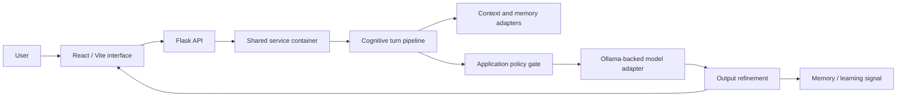

# Lyrian / HybridOctoMem

**An experimental memory and cognition system with a local-model adapter**  
**Source:** private repository  
**Status:** documented experimental prototype, not a finished product

## Overview

Lyrian combines the HybridOctoMem memory runtime with a cognitive turn pipeline, policy and trust modules, a Flask API, and a React/Vite interface. Earlier names including ANDY_2 and Janus are historical phases documented by the current repository; the canonical project is Lyrian.

## Engineering problem

An interactive assistant needs more than a model call: it must assemble relevant context, apply application-level policy, produce a response, and connect that response to memory and user-facing controls. Lyrian is an experiment in making those stages explicit and inspectable.

## Architectural approach

The backend creates shared services for chat, activity, memory and cognition. A cognitive turn parses the input, builds context, applies an ethos gate, calls an LLM adapter, refines output and optionally records a learning signal. The inspected adapter uses an Ollama-backed local model path. A separate memory client wraps the HybridOctoMem runtime for backend services. The React/Vite frontend exposes dashboard, chat, memory, narrative and ethics views through the Flask API.

The diagram describes code-level flow. It does not claim that policy checks guarantee safe output or that learning is autonomous model training.

## Verified technologies

Python with Flask for the API, React/Vite for the dashboard, PyTorch in the memory runtime, and an Ollama-backed model adapter. These are implementation dependencies and integration points, not claims about model quality or deployment scale.

## Implemented capabilities visible in source

- Flask application and route modules for chat, memory, narrative, status, ethics and logs.
- Shared service container for backend-facing services.
- Cognitive pipeline stages for input interpretation, context building, policy gating, model response and refinement.
- Ollama adapter with a readable fallback when the local model service reports an error.
- Memory runtime and wrapper, with supporting cognitive and resource modules.
- React/Vite views and state slices for the product areas named in the README.
- Backend and HybridOctoMem test files exist; tests were not run for this preparation.

## Technical challenges and design decisions

- **Separate orchestration from routes:** the backend delegates to shared cognitive and memory services.
- **Make context assembly explicit:** memories and other contextual signals are composed before model generation.
- **Keep a local-model path:** model access is behind an adapter and configured outside the core orchestration function.
- **Expose inspectable surfaces:** logs, memory and policy-related views are represented in the frontend and API.
- **Preserve historical lineage without multiplying canonical repositories:** prior project names are treated as history within Lyrian.

## Current status and limitations

The project README explicitly labels Lyrian an experimental prototype. Local model availability, memory quality, policy effectiveness, long-term behavior and resource requirements need runtime evaluation. The presence of ethics/trust modules is not evidence of a safety guarantee. This preparation did not execute the backend, model, browser application or tests.

## Lessons learned

- A cognitive system is easier to evaluate when context, policy, generation and memory are separate stages.
- An adapter boundary makes local-model integration replaceable, but does not remove operational dependencies on the model service.
- Memory retrieval and response quality need task-based evaluation; module presence alone cannot establish useful recall.
- A research prototype should state its limits as plainly as its architecture.

## Evidence checked

Private-source review covered the README and technical documentation, backend entry points and shared services, cognitive pipeline modules, memory adapter, frontend views, and test collection. Exact private source paths and prompt or memory contents are omitted.

**Confidence:** high for repository structure and orchestration stages; medium for runtime integration; model quality, privacy behavior and system-level safety not independently verified.
