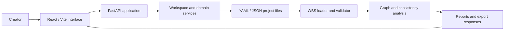

# TOYB World Building System

**A file-based system for structured narrative worlds and AI-assisted analysis**  
**Source:** private development repository  
**Status:** private product prototype; production readiness not assessed

## Overview

TOYB's World Building System (WBS) models narrative projects as linked, structured data. The design keeps source material in files and makes relationships, validation and graph analysis available to both a web application and programmatic tools.

This write-up discusses software architecture only. It contains no story text, manuscript excerpts, private world names, character details or project datasets.

## Engineering problem

Large creative projects accumulate entities and cross-references across files. Unstructured notes are difficult to validate, navigate, export or pass safely to assistive tools. WBS applies a typed, file-based domain model and explicit validation to that problem.

## Architectural approach

The inspected repository contains a Python WBS library for loading, validating and analyzing structured content, a FastAPI service with domain routers and workspace/auth components, and a React/Vite frontend with typed state and graph-oriented UI code. YAML and JSON are supported as project data formats. The pipeline can report validation and relationship information; graph analysis computes structural summaries from nodes and edges.

The diagram abstracts the canonical source. It does not include private content or deployment details.

## Verified technologies

Python and FastAPI on the service side; React, Vite and TypeScript in the frontend; Cytoscape-related graph visualization dependencies; YAML and JSON as documented project-data formats.

## Implemented capabilities visible in source

- Python loader and validation pipeline for structured project data.
- Graph-analysis helpers for connected content and relationship summaries.
- FastAPI application and routers across project-domain areas.
- Workspace context, path resolution and manager-registry modules.
- React/Vite client with typed state and graph visualization dependencies.
- Test files covering server authentication and workspace behavior, among other areas; tests were not run for this preparation.

## Technical challenges and design decisions

- **Files as the domain boundary:** the project data remains inspectable and portable instead of being hidden inside one database.
- **Validation before analysis:** required fields and references can be checked before graph and AI-oriented workflows consume them.
- **Workspace abstraction:** path and context resolution make the active workspace explicit.
- **Separate interface and domain behavior:** the browser uses API boundaries while Python modules own loading and analysis.
- **Export as a product capability:** the README documents project exports; the exact output may contain private material and is deliberately not reproduced here.

## Current status and limitations

The code and documentation support describing a substantial prototype. This audit did not run the application, inspect private manuscripts, verify all routes, or validate export contents. No claim is made that all workspace, authentication, AI or export paths are production-ready.

## Lessons learned

- Creative software benefits from explicit schemas and referential validation just as business software does.
- Keeping data in files can support reviewability, but requires careful path, workspace and export boundaries.
- Graph views become more useful when analysis reports structural warnings rather than only drawing edges.
- Public technical storytelling can explain the architecture without exposing the creative material stored in it.

## Evidence checked

Private-source review covered the project overview, Python domain and analysis components, API and workspace layers, frontend structure, and test collection. No private narrative material or exact repository paths are included here.

**Confidence:** high for the listed architectural components; medium for feature completeness; runtime, security and production suitability not verified.
