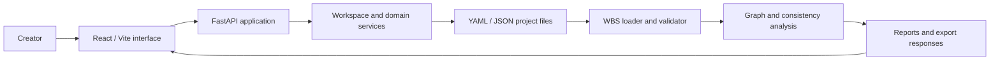

# TOYB World Building System

**Structured narrative modeling, validation, and graph analysis**  
**Source:** private development repository  
**Status:** private product prototype; production readiness not assessed

## Overview

TOYB's World Building System (WBS) models narrative projects as linked, structured data. The design keeps source material in files and makes relationships, validation and graph analysis available to both a web application and programmatic tools.

The case study focuses on the software architecture and does not reproduce narrative text, private world names, character details, or project datasets.

## Engineering problem

Large creative projects accumulate entities and cross-references across files. Unstructured notes are difficult to validate, navigate, export or pass safely to assistive tools. WBS applies a typed, file-based domain model and explicit validation to that problem.

## Architectural approach

The system combines a Python WBS library for loading, validating, and analyzing structured content with a FastAPI service, domain routers, workspace/auth components, and a React/Vite frontend with typed state and graph-oriented UI code. YAML and JSON are supported as project data formats. The pipeline reports validation and relationship information; graph analysis computes structural summaries from nodes and edges.

The diagram summarizes the system flow without exposing project content or deployment details.

## Technology Stack

Python and FastAPI on the service side; React, Vite and TypeScript in the frontend; Cytoscape-related graph visualization dependencies; YAML and JSON as documented project-data formats.

## Implemented Capabilities

- Python loader and validation pipeline for structured project data.
- Graph-analysis helpers for connected content and relationship summaries.
- FastAPI application and routers across project-domain areas.
- Workspace context, path resolution and manager-registry modules.
- React/Vite client with typed state and graph visualization dependencies.
- Test suites for server authentication and workspace behavior, among other areas, are included in the repository.

## Technical challenges and design decisions

- **Files as the domain boundary:** the project data remains inspectable and portable instead of being hidden inside one database.
- **Validation before analysis:** required fields and references can be checked before graph and AI-oriented workflows consume them.
- **Workspace abstraction:** path and context resolution make the active workspace explicit.
- **Separate interface and domain behavior:** the browser uses API boundaries while Python modules own loading and analysis.
- **Export boundaries:** project exports can contain project-specific material, so the scope of exported data is an important design consideration.

## Current status and limitations

WBS is a substantial software prototype and is not presented as production-ready. Behavior across all routes, workspace and authentication cases, and export paths requires broader evaluation. Export responses may contain project-specific material, making clear workspace and export boundaries important to the system's design.

## Lessons learned

- Creative software benefits from explicit schemas and referential validation just as business software does.
- Keeping data in files can support reviewability, but requires careful path, workspace and export boundaries.
- Graph views become more useful when analysis reports structural warnings rather than only drawing edges.
- Public technical storytelling can explain the architecture without exposing the creative material stored in it.

